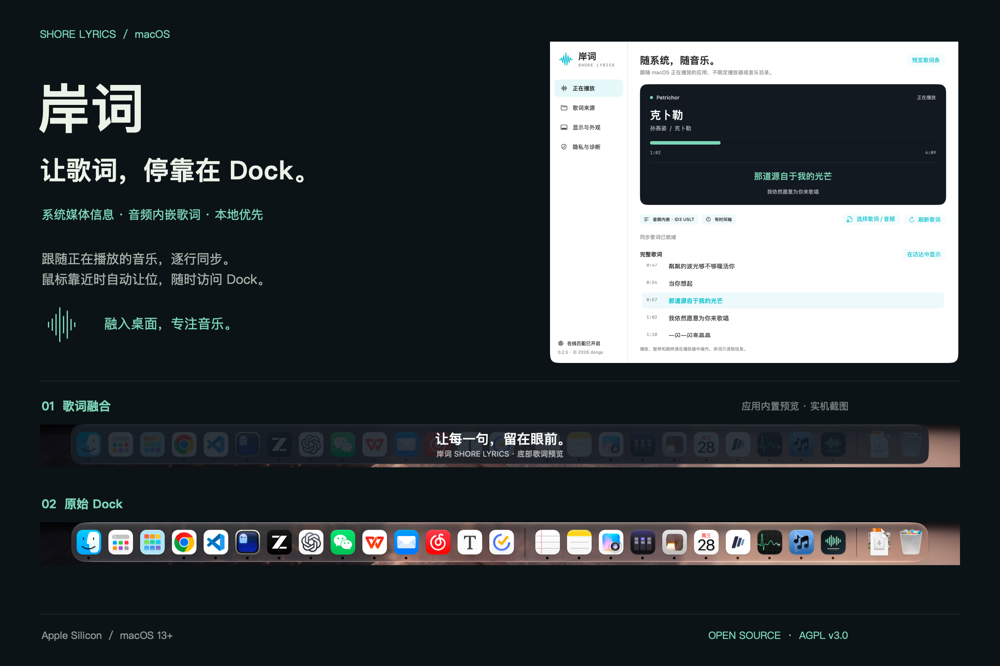
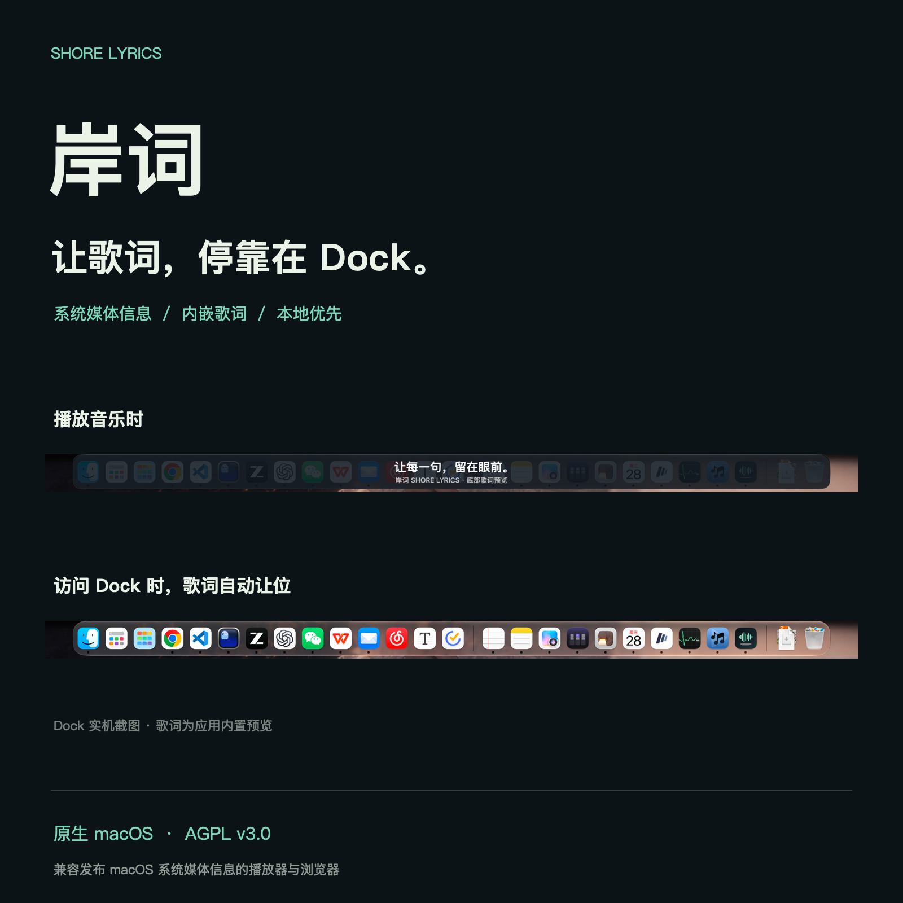
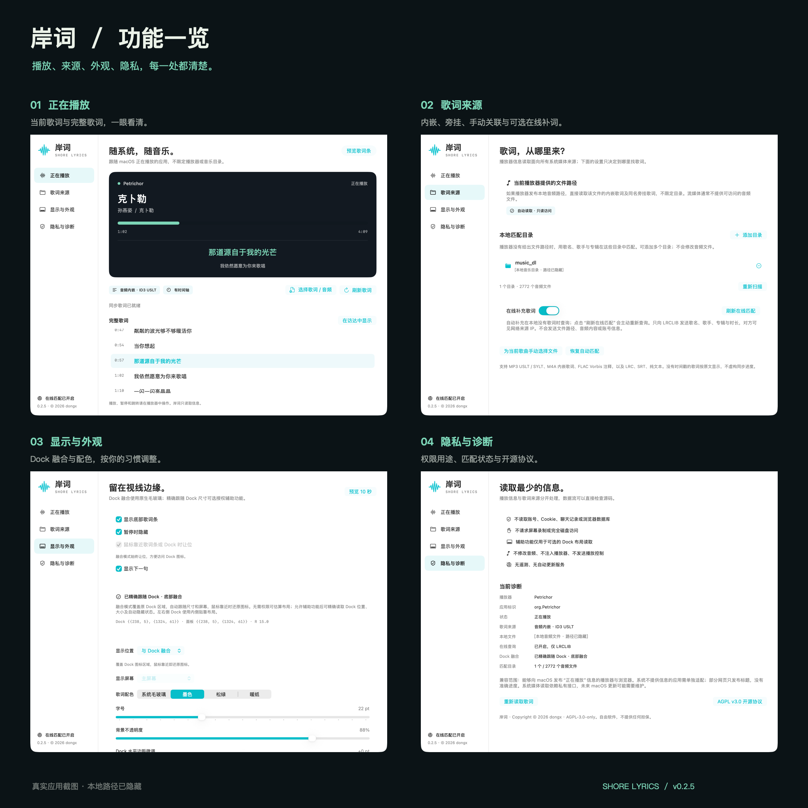

# 岸词 · Shore Lyrics

原生 macOS 歌词应用，将歌词融入 Dock。

[](#安装)
[](#安装)
[](#开发)
[](LICENSE)

支持系统媒体信息读取、音频内嵌歌词和可选在线匹配。



[功能](#功能) · [界面预览](#界面预览) · [安装](#安装) · [使用](#使用) · [兼容性](#兼容性) · [开发](#开发) · [贡献](#贡献) · [许可证](#许可证)

## 功能

| 功能 | 说明 |
| --- | --- |
| Dock 融合 | 歌词覆盖底部 Dock 区域，跟随其位置和尺寸；鼠标靠近时自动让位。另提供 Dock 上方浮窗和屏幕底边窄条。 |
| 系统媒体读取 | 跟随 macOS 的 Now Playing 信息，不设播放器白名单，不限制音乐文件所在目录。 |
| 内嵌歌词 | 原生读取 MP3、M4A、FLAC 的常见歌词标签，支持带时间轴的同步歌词。 |
| 本地歌词 | 读取 LRC、SRT 和纯文本，支持多时间戳、翻译、时间偏移及常见文本编码。 |
| 歌词动效 | 第一行随播放进度染色，亮带跟随染色前沿；按实际字宽推进，换句轻柔上移并淡入淡出。可开启或关闭流光，并自定义颜色。 |
| 双行显示 | 第一行显示当前歌词，第二行优先显示同时间戳的翻译，否则显示下一句；第二行保持原色。 |
| 在线匹配 | 通过 LRCLIB 补充歌词，默认关闭；可选择优先使用在线歌词，匹配失败时使用本地歌词。 |
| 暂停与刷新 | 暂停状态下仍可匹配歌词，使用 `⌘R` 重新读取当前歌曲。刷新失败时保留已有歌词。 |
| 外观设置 | 三种显示位置、四种配色，以及字号、透明度、双行显示和同步偏移设置。 |

## 界面预览

| Dock 体验 | 设置界面 |
| :---: | :---: |
|  |  |
| 播放时显示歌词，访问 Dock 时自动让位。 | 播放状态、歌词来源、显示设置和隐私诊断。 |

Dock 来自同一设备的实机截图，歌词使用应用内置预览文字。具体外观取决于系统版本、Dock 配置和所选配色。[查看界面截图](docs/screenshots/README.md)。

## 安装

### 系统要求

- Apple Silicon Mac。
- macOS 13 或更高版本。
- 播放器需要向 macOS 发布可用的“正在播放”信息。

通过源码构建安装：

```sh
git clone https://github.com/Zorabi/shore-lyrics.git
cd shore-lyrics
./build.sh
open build/岸词.app
```

构建工具要求见[开发](#开发)。构建完成后，可将 `build/岸词.app` 复制到“应用程序”。源码构建的应用未经过 Apple 公证。

## 使用

1. 打开岸词，在播放器中播放歌曲。
2. 岸词自动读取系统媒体信息，并尝试匹配歌词。
3. 在“歌词来源”添加可选的音乐目录，或为当前歌曲手动选择歌词 / 音频文件。
4. 在“显示与外观”选择显示位置和配色；使用“预览 10 秒”检查布局。
5. 若需精确跟随 Dock，在同一页面发起授权，再到系统“隐私与安全性 → 辅助功能”中允许岸词。

点击 Dock 图标或菜单栏波形图标打开设置。使用 `⌘W` 或关闭按钮关闭设置窗口，不会退出应用；退出请使用应用菜单。

### 歌词显示与流光

在“显示与外观”中调整歌词条，配置会自动保存在本机。

| 选项 | 作用 |
| --- | --- |
| 歌词流光效果 | 开启或关闭第一行大歌词的进度染色 |
| 普通 LRC 扫光速度 | 50%–200%，默认 138%；100% 按整句时长推进，数值越大越早完成染色，调整后即时生效并自动保存 |
| 流光颜色 | 使用系统选色器自定义染色与亮带颜色；关闭流光时不可编辑 |
| 显示第二行（翻译或下一句） | 有同时间戳翻译时优先显示翻译，否则显示下一句；不参与染色 |
| 歌词配色 | 选择系统毛玻璃、墨色、松绿或暖纸 |
| 字号与背景不透明度 | 调整文字大小和背景；Dock 融合的系统毛玻璃背景不支持不透明度调节 |
| 同步微调 | 在 −5 至 +5 秒内调整歌词时间，正值提前、负值延后 |

流光同时用于歌词条和“正在播放”页。增强 LRC 根据 `<分:秒.毫秒>` 时间戳推进；普通 LRC 及其合并翻译按句时长估算，扫光速度可在“显示与外观”中调整；SRT 按时间段估算。速度选项不影响逐字时间戳、SRT 或换句时间。估算不能保证与每个字的演唱时刻一致，换句仍跟随原时间轴。纯文本没有同步染色。

播放暂停时染色停止，播放进度的小幅校正会平滑处理，避免染色反复回退；明显的进度跳转会重新对齐。动效会跟随 macOS 辅助功能中的“减少动态效果”设置：启用该系统设置后，保留进度染色，关闭亮带和换句过渡。岸词内没有单独的“减少动态效果”开关。“预览 10 秒”用于检查静态文字与布局，不演示同步流光。

### 没有匹配到歌词时

本地和在线都没有可用歌词时，歌词条仍按显示设置保留：第一行显示歌曲名称，开启第二行时显示未匹配到歌词或查询失败的状态，不进行流光染色。“正在播放”页会显示“还没有找到歌词”，可手动选择文件或重新匹配。

暂停时仍遵循“暂停时隐藏”设置。若在线来源明确标记为纯音乐，则显示“纯音乐”。

### 常用快捷键

| 快捷键 | 操作 |
| --- | --- |
| `⌘,` | 打开设置 |
| `⌘W` | 关闭当前窗口，保留后台运行 |
| `⌘M` | 最小化当前窗口 |
| `⌘H` / `⌥⌘H` | 隐藏岸词 / 隐藏其他应用 |
| `⌘R` | 刷新歌词 |
| `⌘Q` | 退出岸词 |

编辑菜单提供系统标准的撤销、重做、剪切、复制、粘贴和全选，仅在当前焦点支持时启用。

### 歌词来源

播放器信息读取与歌词文件匹配相互独立。添加目录只决定去哪里查找歌词，不限制可读取的播放器。

| 来源 | 匹配方式 |
| --- | --- |
| 播放器提供的本地文件 | 若系统媒体信息包含可读的本地音频 URL，直接读取内嵌歌词及同名旁挂歌词，无需添加目录 |
| 音乐目录 | 未提供本地文件 URL 时，根据歌名、歌手和专辑在用户添加的目录中匹配 |
| 手动关联 | 为当前歌曲选择任意可访问位置的音频或歌词文件，并保存关联 |
| 在线匹配 | 开启后默认在本地无歌词时查询 LRCLIB；启用“优先使用在线歌词”后，即使已有本地歌词也会查询，成功时优先显示在线结果 |

在“歌词来源”中开启“在线补充歌词”后，可启用“优先使用在线歌词”（默认关闭）。选项变更后会重新匹配当前歌曲：查询期间显示本地歌词，匹配成功后切换到在线结果；无结果或查询失败时继续使用本地歌词。该选项适用于内嵌、旁挂和手动选择的歌词，只影响显示来源，不修改原文件。关闭在线补充后不会发起网络查询。

在线匹配仅下载歌词文本及相关信息，不下载音频；流光绘制不产生网络流量。流量取决于歌词长度与连接开销。匹配成功的结果缓存在内存中，主动重新匹配会再次请求，退出后缓存清空。

### 刷新与同步

- `⌘R` 或“刷新歌词”：重新读取当前歌曲并匹配歌词，暂停时也可使用。
- “刷新在线匹配”：主动重新查询 LRCLIB，需要先开启在线匹配；查询中按钮显示为“重新在线匹配”，可取消旧请求并重试。查询超时会结束等待并保留已有歌词；已获取当前歌曲信息时，在线重试不会重启系统媒体读取。
- “同步微调”：正值让歌词提前，负值让歌词延后。
- “暂停时隐藏”：仅控制歌词条显示，不影响歌词读取与匹配。

## 兼容性

### 播放器

岸词通过系统媒体通道读取歌曲，已在 Petrichor 和网易云音乐上进行实际验证。其他播放器和浏览器能否使用，取决于其发布的系统媒体信息。

- 未发布媒体信息的播放器需要专门适配。
- 部分网页仅提供标题，缺少准确的进度或时长。
- 流媒体通常不提供可访问的音频路径，需使用本地关联或在线歌词。
- 系统媒体读取依赖私有 MediaRemote 接口，macOS 更新可能影响兼容性。

### 歌词格式

| 类型 | 支持范围 |
| --- | --- |
| MP3 | ID3v2.3 / ID3v2.4，USLT、基于毫秒时间戳的 SYLT |
| M4A | `©lyr` 内嵌歌词 |
| FLAC | Vorbis 歌词注释 |
| LRC | 同步时间戳、多时间戳、同时间戳翻译、offset，以及增强 LRC 的逐字时间戳 |
| SRT | 时间段与段落间隔 |
| 纯文本 | 原文显示，不生成虚构的同步时间轴 |
| 文本编码 | UTF-8、UTF-16、GB18030 等 |

其他音频格式会尝试通过 AVFoundation 读取，但不保证支持。同名多版本无法可靠区分时，需要手动选择文件。

### Dock 布局

底部 Dock 使用原位融合；左右侧 Dock 使用内侧贴靠布局。未授予辅助功能权限时采用估算布局，自动隐藏动画的判断可能不准确。

## 隐私与权限

- **文件访问**：读取播放器提供的可访问音频、用户添加的目录或手动选择的文件，不修改音频。
- **辅助功能（可选）**：只用于读取 Dock 的位置、尺寸及自动隐藏状态。不控制播放器或 Dock。
- **网络（可选）**：在线匹配默认关闭。开启后仅向 `https://lrclib.net/api/get` 发送歌名、歌手、专辑和时长，服务端可见来源 IP。
- **缓存与设置**：在线歌词仅缓存在内存中，退出即清空；显示偏好、目录与文件关联保存在本机。

不上传音频、文件路径或本地文件列表，不读取账号、Cookie、聊天记录或浏览器数据库。不包含遥测和自动更新，不请求屏幕录制或完全磁盘访问。

当前未启用 App Sandbox。本地优先的读取策略不等同于系统级文件隔离。

## 开发

### 工具链

- Xcode 命令行工具：Swift 编译器与 macOS SDK。
- Python 3 与 OpenSSL：用于本机签名初始化。
- macOS 自带的 `security` 和 `codesign`。

没有第三方运行时依赖。当前构建脚本生成 arm64 应用，最低部署目标为 macOS 13；尚未提供 Intel 构建。

### 构建与测试

```sh
./build.sh
./test.sh
./test-refresh.sh
./test-karaoke.sh

# 可选：验证自己选择的音乐目录
./test.sh --music-root /path/to/music
```

| 命令 | 检查内容 |
| --- | --- |
| `./test.sh` | 歌词解析、编码、音频标签、本地匹配、播放时钟和 Dock 几何 |
| `./test-refresh.sh` | 暂停启动、在线优先级、查询中重试、超时回退、过期回调、配置保存与播放进度；HTTP 请求使用模拟响应 |
| `./test-karaoke.sh` | 中英文与组合字符排版、染色边界、重绘残影、换句画面和过渡期间的可见性 |

渲染检查会生成 `build/karaoke-preview.png`，供本机查看浅色、深色和不同流光颜色的静态效果。

本机构建与签名维护说明见[开发说明](docs/development.md)。

### 项目结构

```text
Sources/      应用、界面、歌词解析、媒体读取与 Dock 布局
Resources/    系统媒体桥与应用图标
Tests/        核心、刷新与歌词渲染测试
Tools/        签名、图标和宣传图生成工具
docs/         界面截图与宣传素材
```

只读诊断会在约 6 秒后退出，报告不包含歌词原文：

```sh
./build/岸词.app/Contents/MacOS/ShoreLyrics --diagnose
```

## 贡献

欢迎通过 [Issues](https://github.com/Zorabi/shore-lyrics/issues) 报告问题或提出改进，通过 Pull Request 提交修改。

反馈兼容性问题时，请提供 macOS 版本、播放器名称及版本、歌曲播放状态，以及岸词中的匹配状态。日志和截图请先移除本地路径或其他个人信息。

修改歌词解析、匹配或播放状态逻辑时，请补充相应测试，并运行核心与刷新测试；调整染色、排版或换句动效时，还需运行歌词渲染测试。界面修改请附截图，动效问题建议附录屏。提交中不要包含签名材料、音乐文件、未经授权的歌词文件或构建产物。

## 许可证

本项目采用 [GNU Affero General Public License v3.0](LICENSE)（`AGPL-3.0-only`）。版权说明见 [NOTICE](NOTICE)。

截图中的歌曲、歌词与第三方商标归各自权利人所有，不包含在项目代码的授权范围内。

## 相关链接

- [更新记录](CHANGELOG.md)
- [LRCLIB API 文档](https://lrclib.net/docs)
- [Apple 媒体元数据文档](https://developer.apple.com/documentation/avfoundation/retrieving-media-metadata)

Copyright (c) 2026 dongx。
本项目基于 [GNU Affero General Public License v3.0](LICENSE) 发布。
