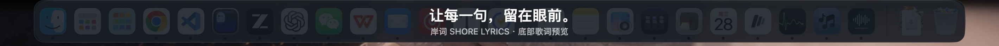
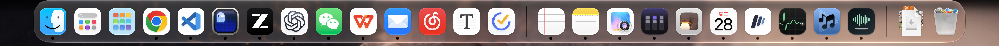
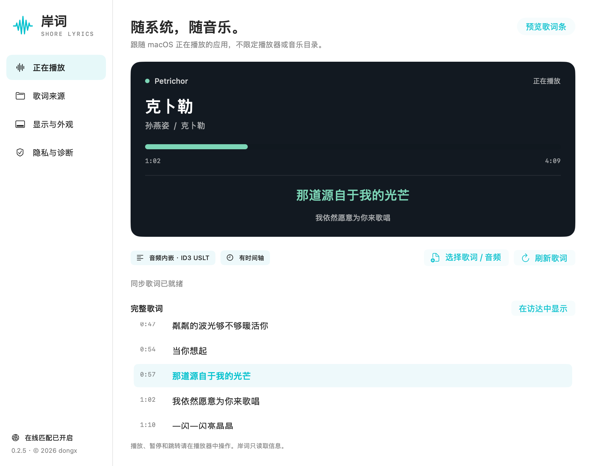
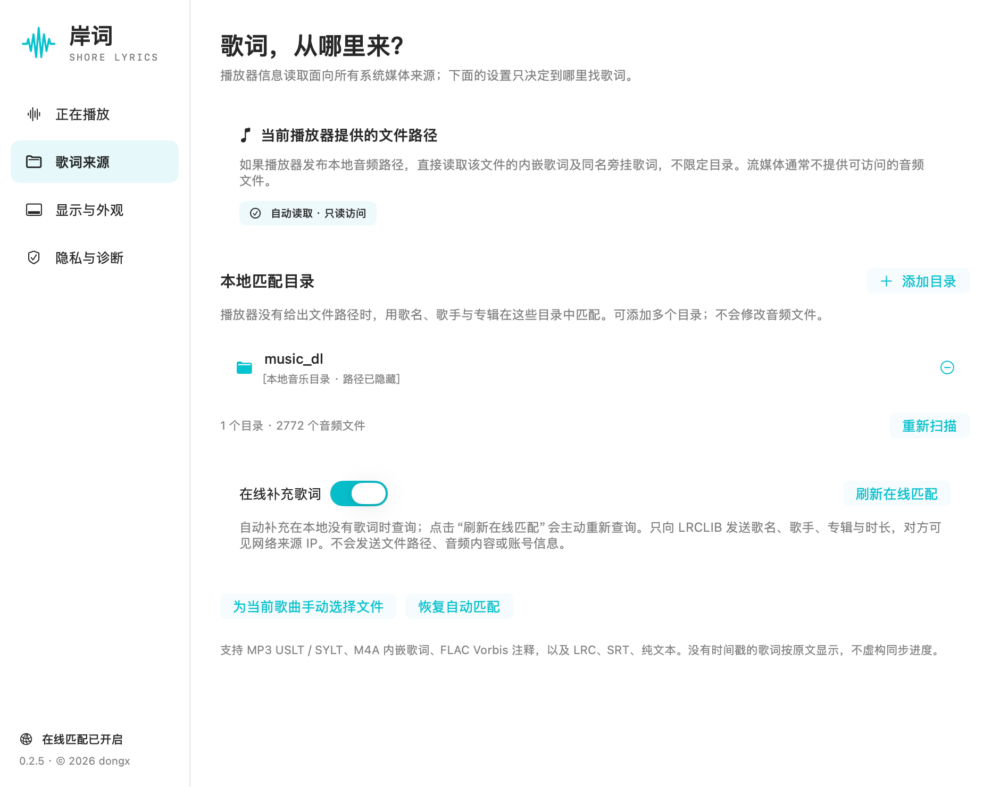
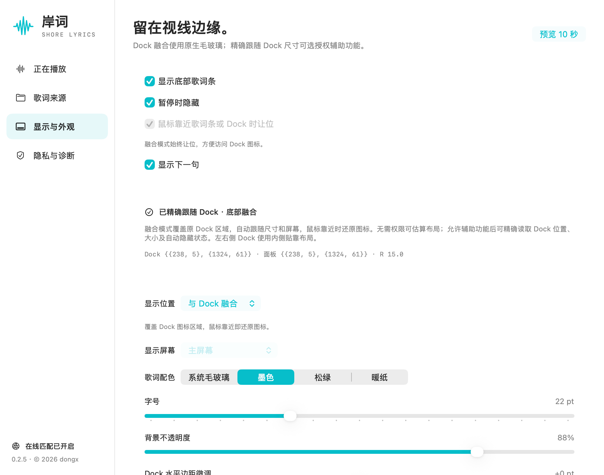
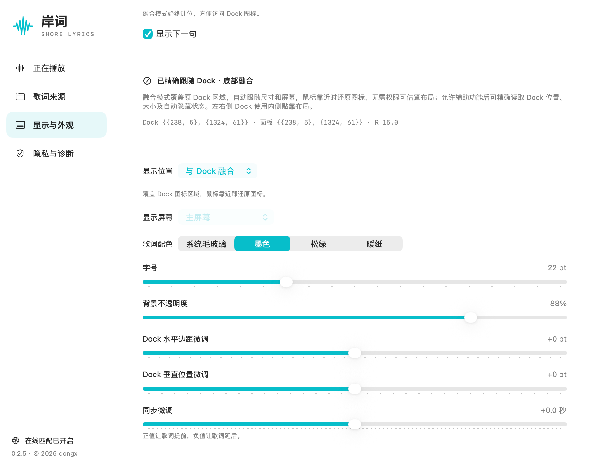
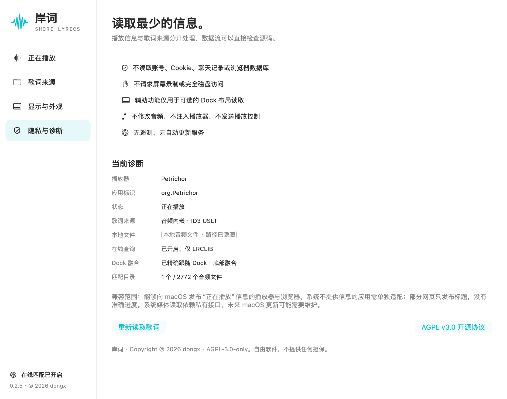

# 界面截图

以下截图来自实际运行的应用。系统录制标识已裁去，本地目录和文件路径已遮盖。

## Dock 融合

应用内置预览文字，底部 Dock 原位显示。

## 原始 Dock

## 正在播放

播放器状态、当前歌词、完整歌词和刷新入口。

## 歌词来源

本地文件读取、可选音乐目录和在线补词。

## 显示与外观

显示策略、Dock 布局、位置与配色。

字号、透明度、Dock 微调与同步偏移。

## 隐私与诊断

权限用途、当前歌词来源和匹配状态。

截图中的播放器名称只表示拍摄时的媒体来源。在线开关及配色反映拍摄时的设置，不代表默认配置。

[返回项目首页](../../README.md)
